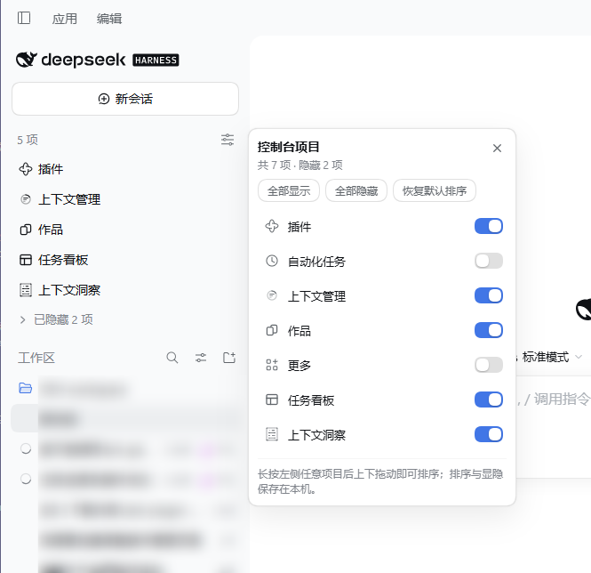

# dsh-sidebar-console · Sidebar Console Manager

[中文](README.md) · English

A manager for the left-sidebar console (the global panel list) of DeepSeek Harness (DSH) Web. When installing plugins turns the sidebar into a mess, this plugin hands ordering and visibility back to you.

 



## Features

| Need | How it works |
| --- | --- |
| Reorder by long-press drag | **Long-press 300 ms** on any sidebar panel entry, then drag up or down. No grab handle, no edit mode. The dragged entry follows the pointer semi-transparently while the others make room in real time |
| Order is pinned against plugin updates | Order is persisted per panel **id** on the Host (`$DSH_HOME/storages/dsh-sidebar-console/layout.json`). Saved entries always render in your order; a plugin update only changes its own `order` declaration and never moves what you arranged. Newly installed plugins are appended at the end — drag once and you are done |
| One manager button | The top row of the panel list shows the **number of visible entries** (`N items`) on the left and an icon **Manage** button on the right, which opens a manager popover |
| Bulk show / hide | Each panel gets a row in the popover: icon + name + visibility switch + move up / move down. The header offers **Show all / Hide all / Restore default order** |
| Hidden section | Hidden entries leave the list and a **Hidden N items** row appears at the bottom; its chevron expands or collapses them (they stay clickable when expanded) |
| Collapsed sidebar support | When the sidebar collapses to the icon rail, the manager entry and hidden section shrink to 36×36 icon rows with the count as a badge |

Other details:

- **Keyboard accessible**: focus any panel entry and press `Alt+↑` / `Alt+↓` to move it; every control in the popover is a native `button` and the switches use `role="switch"`.
- **No React nodes moved**: only `style.order`, `style.display` and its own `data-*` markers are used, replayed automatically after host re-renders. No host code is modified and no official package is patched.
- **Hash-independent selectors**: only class-name fragments are used (`panelList`, `panelRow`, `moreAnchor`, `collapsed`), so a DSH upgrade that changes hash prefixes does not break it.
- **Consistent everywhere**: the layout lives on the Host, so page reloads, port changes and cleared browser data do not lose it (localStorage is only a first-paint mirror).
- **Uninstall restores everything**: disabling or reloading the plugin removes every `order` / `display` / marker it wrote, returning the sidebar to its stock state.

## Install

Option 1 (recommended, plugin manager):

```text
plugin_manager action=install_bundle target=D:\DSH-workspace\dsh-sidebar-console
```

Or install manually in the profile directory:

```bash
cd C:/Users/<you>/.dsh/profiles/desktop
npm install "file:D:/DSH-workspace/dsh-sidebar-console"
# then add "dsh-sidebar-console" to dsh.profile.bundles in package.json,
# and add a row to cordis.patch.yml:
#   - insert:
#       - id: dsh-sidebar-console
#         name: dsh-sidebar-console
```

**Restart the DSH desktop app** (or follow the in-app prompt) to load the plugin; the count and manager button appear at the top of the sidebar on first load.

## Usage

1. **Reorder**: hold any panel entry for about 0.3 s, drag it to the target position and release. It saves on release and survives reloads and restarts.
2. **Manage**: click the slider icon at the top of the list to open *Console entries*.
   - Single: flip the switch at the end of a row to hide/show it; use the row's `↑`/`↓` to nudge the order.
   - Bulk: `Show all` / `Hide all`, and `Restore default order` to go back to the official registration order.
3. **Hidden section**: once at least one entry is hidden, a *Hidden N items* row appears at the bottom — click it to expand or collapse.

> The *More* row (the host's own More menu entry) participates in ordering and visibility like any other entry. Even if you hide it you can bring it back from the manager button, so you cannot lock yourself out.

## Data and API

- State file: `$DSH_HOME/storages/dsh-sidebar-console/layout.json` (atomic write: temp file then rename)
- State shape:

```json
{ "version": 1, "order": ["<panel id>", "..."], "hidden": ["<panel id>"], "expanded": false, "updatedAt": 0 }
```

- Host routes (Connection exact routes, owner browser only, POST JSON):
  - `POST /api/dsh-sidebar-console/state` → `{ok:true, value: layout}`
  - `POST /api/dsh-sidebar-console/save` → `{ok:true, value: layout}` (body is the layout)

## Layout

```
dsh-sidebar-console/
├─ package.json       dsh manifest: bundle patch + client platform/injection order
├─ cordis.patch.yml   a single insert host row
├─ index.js           Host half: connection routes + layout storage
├─ lib/store.js       atomic JSON storage, sanitizing and merging
├─ client.js          browser half: long-press drag, manager popover, hidden section, replay loop
├─ locale/{zh,en}.json titles/descriptions shown by the plugin manager
├─ icon.svg           plugin icon
├─ dsh.plugin.json    plugin-market metadata
└─ docs/screenshots/  README screenshots
```

## Compatibility

- Target: DSH `>=0.2.1-rc.3 <0.3.0-0` (all of 0.2.x including prereleases; Web, desktop and browser behave the same; `0.2.2-rc.5` is the version this was last checked against). The `<0.3.0-0` upper bound also blocks `0.3.0-rc.*`.
- Version gate: the manifest declares `engines.dsh` as a **range**. Once that field exists DSH judges by it alone and ignores `peerDependencies`; an unmet range makes the composition preflight silently disable the whole plugin (one line on stderr). Do **not** put back an exact-version whitelist — that breaks once per DSH release.
- Host structure it relies on (re-checked on 0.2.2-rc.5): `nav[class*=panelList]` is the panel list inside the sidebar root, and every panel row is a `button[class*=panelRow]`. Since 0.2.2-rc.3 each row sits inside an extra `div[class*=panelEntry]`; the plugin walks the nav's direct children and looks for row buttons inside them, so it works with or without that wrapper. The *More* entry lives in a `[class*=moreAnchor]` wrapper and its row button carries `aria-haspopup="menu"`. The collapsed state is marked by the ancestor class fragment `_collapsed` (the real class is `<hash>_collapsed`).
- If DSH ever restructures the sidebar, the plugin degrades silently (no nav, no changes) instead of throwing or breaking the UI. If a feature disappears after an upgrade, check the browser console for `dsh-sidebar-console: sync failed`.

## Verification

- E2E (real DSH 0.2.2-rc.1 + isolated profile + headless Edge/CDP): `node e2e/cdp.mjs --url "<token url>" --script e2e/verify-console.mjs`
- Covers: plugin load, long-press reordering, count changes, single hide, expanding the hidden section, persistence of order/visibility/expanded state across a full reload, show-all, the collapsed rail, and a clean console.
- Latest result: **10/10 passed**.

## Known limits

- On touch devices you must keep holding after the long press before dragging (mobile browsers claim the gesture for scrolling first); the desktop experience is the most complete.
- With a very large number of panels the list grows with the sidebar; ordering and hiding still work, but no extra scroll-height cap is added (to avoid changing the host layout).
- Order and visibility are preferences of **this installation**; they do not sync across workspaces or accounts.

## License

MIT License, Copyright (c) 2026 dsh-sidebar-console contributors.

Free to use, modify and redistribute under the MIT license; see [LICENSE](LICENSE) for the full text.
